# Underhood

<p align="center"></p>

Five Claude skills for modding games and apps you own: find out how a game is built, reverse
engineer what the mod needs, build it, check it in the real game, make the art on your own GPU,
and ship it.

Most people never learned the reverse-engineering side: what an AES pak key is, why a file has
entropy 8.0, what an RVA or an AOB signature is, how a proxy DLL gets code into a game. Underhood
gives Claude that knowledge as playbooks for 15 engine families, an RE primer and a REA tool map.
Claude opens the one it needs for the current step.

<p align="center"></p>

| skill | what it does |
| --- | --- |
| `/underhood-recon` | Engine and version, managed or native, anti-cheat verdict, loaders, saves, prior field notes, the community route. Writes `MODDING_PLAN.md`. |
| `/underhood-dig` | Reverse engineering: .NET, IL2CPP, Java, native through REA/Ghidra/IDA, Electron and APKs, pak AES keys, unknown formats with a round trip, saves and checksums, live memory, hooks. |
| `/underhood-forge` | Route, backup, vertical slice, loader code or hooks, in-game test scenes and bridges, launching and capture. Also ports of old mods and cross-game mashups. |
| `/underhood-art` | Sprites, icons, textures, 3D, SFX, music and voice from local models (ComfyUI), then the exact files the engine loads: cutout, pixel fit, sheets, 3D to sprites. |
| `/underhood-ship` | Lint for game files, decompiled code and leaked keys, packaging, a 20 to 45 s showcase clip, and a field note for the next agent. |

Free: no paid API, no credits, no key. Bring your own Ghidra or IDA if you want native decompilation.

## Built to be cheap on tokens

<p align="center"></p>

| work | how Underhood does it |
| --- | --- |
| knowing what's loaded | Five short skill files and one `RULES.md`. 244 KB of engine playbooks, RE guides and case studies stay on disk until a step names one. |
| fingerprinting a game | `uh scan` reads the install and prints engine, anti-cheat, loaders, saves and ranked routes. |
| identifying a file | `uh probe` prints magic, entropy per block, zlib streams and a verdict in under ten lines; `--known` recovers a XOR key. |
| reading binaries | REA summary first, then single pages through `inspect_analysis_view`. Decompiled trees go to disk and get grepped. |
| prior art | `uh kb search` over 120+ field notes from other agents, synced from GitHub. |
| checking the game | logs and in-mod bridges first; screenshots at one third scale, one at a time. |
| resuming | `underhood/state.json` holds target, route, paths, step and open unknowns. |

## Install

As a plugin in Claude Code:

```
/plugin marketplace add Bambeek/underhood-skill
/plugin install underhood@underhood
```

The plugin puts `uh` on PATH. It needs [uv](https://docs.astral.sh/uv/) (it installs Pillow, numpy
and PyYAML on first run), or Python 3.10+ with those three packages.

For `/underhood-dig`, register REA once (free, MIT):

```
npx -y rea-agents@latest setup --client claude_code --dry-run
```

Optional, per task: ComfyUI for art, Blender for 3D-to-sprite, ffmpeg for video (`uh win setup`
fetches a checksummed build on Windows), Ghidra or IDA for native code, ILSpy, Cpp2IL, FModel.

## Tools

```bash
python3 underhood-shared/state.py show
uh scan --list
uh scan "Terraria"
uh probe Content/Paks/pakchunk0-Windows.pak
uh probe save.dat --known 7B22
uh kb search "unreal pak"
uh backup create "<saves>" --name game-saves
uh win launch --steam 105600
uh win shot --exe Terraria.exe shot.png --scale 0.33
uh comfy image "rusty scrap drone, side view" --sprite
uh comfy run workflow_api.json --upload "Load Image.image=concept.png"
uh sprite fit cut.png item.png --size 64x26 --hard-alpha
uh render3d unit.glb frames/ --preset aoe2
uh video compile edl.json out.mp4
uh publish check ./MyMod --game "<install>"
```

Every group has `--help`. Tests: `uv run --with pytest python -m pytest -q tests`

## Rules the skills follow

Full text in [`underhood-shared/RULES.md`](underhood-shared/RULES.md).

- **Your copy, offline.** Games and apps you own, single-player or your own servers.
- **No anti-cheat, no DRM bypass, no multiplayer cheats.** If a mod needs that, Claude stops and
  says so.
- **Keys stay local.** Recovered AES or XOR keys read your own files; they never go into a mod or a
  public note.
- **Nothing of theirs ships.** No game files, decompiled code or extracted assets. Patchers and
  converters that run on your install instead.
- **Backups first, ask first.** Snapshot saves before touching them. Ask before installing into a
  game folder, editing the registry, driving the mouse, deleting or publishing.
- **Evidence, not guesses.** Every claim is observed, inferred or unknown, and the running game has
  the last word.

Reverse engineering can be restricted by a game's licence or by local law. This is not legal
advice.

## License

MIT. Includes MIT-licensed tools, examples and reference material from
[universal-modder](https://github.com/rehan-remade/universal-modder); its notice is in
[LICENSE](LICENSE). REA is a separate install and is not bundled.
